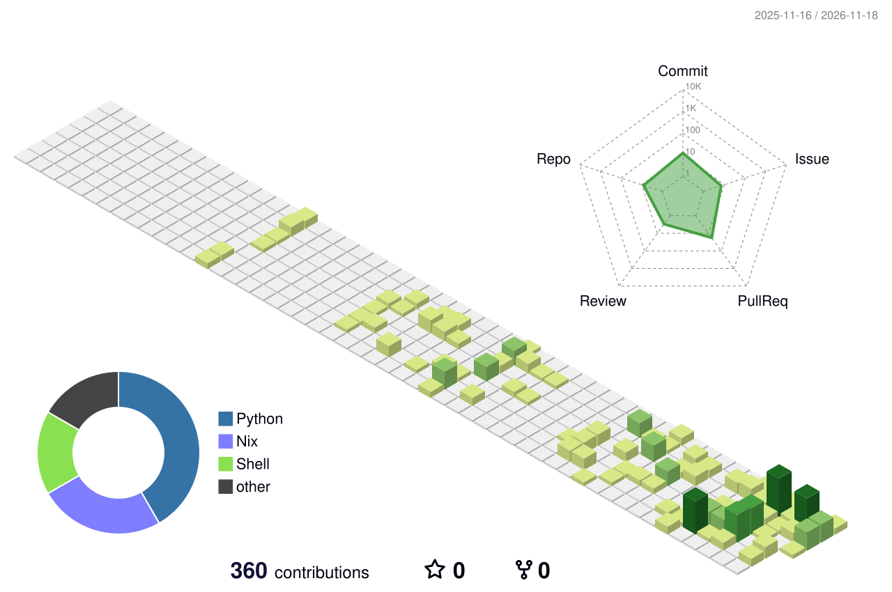

### Hello there, I'm Gwendal

I keep other people's Kubernetes clusters alive.

```yaml
apiVersion: humans.k8s.local/v1
kind: CloudArchitect
metadata:
  name: gwendal
  labels:
    region: europe-west9 # France, approximately
spec:
  replicas: 1
  role: cloud architect @ MSP
  focus: [gke, ovh, scw, terraform/tofu, kubernetes, argocd, etc]
  runtime: nix
  languages: [fr, en]
status:
  conditions:
    - type: Ready
      status: "True"
      reason: PlanReviewed
```

**Things people hand me**

- Infra nobody dares to touch anymore. I bring it back under code, without the outage.
- A `terraform plan` full of changes nobody can explain. I make it say `No changes.`
- Over-provisioned infra and finops nightmares.
- The kube upgrade everyone keeps postponing.
- Dependency hell.

**Lately**

- Improving AI setup to keep track of what's happening in the space
- Reviewing new packages on [nixpkgs](https://github.com/NixOS/nixpkgs)

**Stack**


**Activity**

<picture>
  <source media="(prefers-color-scheme: dark)" srcset="profile-3d-contrib/profile-night-view.svg" />
  <source media="(prefers-color-scheme: light)" srcset="profile-3d-contrib/profile-green-animate.svg" />
  
</picture>

<picture>
  <source media="(prefers-color-scheme: dark)" srcset="https://raw.githubusercontent.com/ZeikoFr/ZeikoFr/output/github-snake-dark.svg" />
  <source media="(prefers-color-scheme: light)" srcset="https://raw.githubusercontent.com/ZeikoFr/ZeikoFr/output/github-snake.svg" />
  
</picture>


